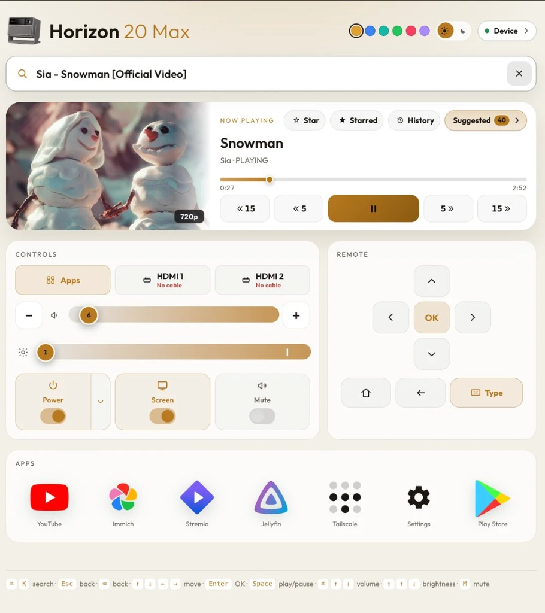
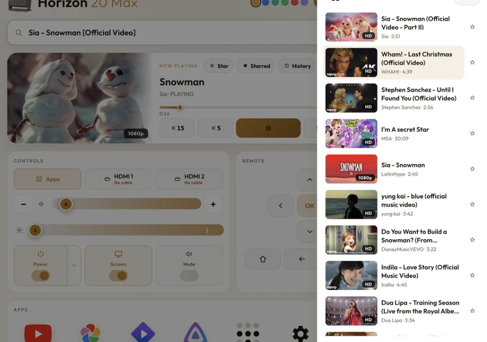
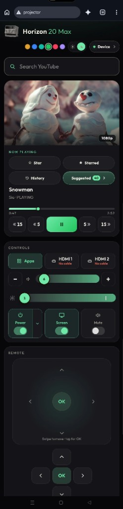

# Horizon Remote

A remote you open in a browser, for an [XGIMI Horizon](https://www.xgimi.com) projector on your home network. It also works as a starting point for other Android TV devices and projectors. The page is only a view. A small server on your LAN owns the connection to the device, so every phone and laptop stays in sync.

It talks to the projector with [Android Debug Bridge](https://developer.android.com/tools/adb) over Wi-Fi. Nothing in this project is meant to leave your LAN. Do not forward the remote or ADB port to the internet.

<p align="center">
  
</p>

<p align="center">
  
</p>

<p align="center">
  
</p>

## Why this exists

The projector already has a remote. A phone is often closer. Stock companion apps are limited, and they do not share one picture of "what is playing" across several screens.

This project keeps that picture on one server:

- The server polls the device, sends keys, and follows the YouTube log.
- Browsers subscribe. When one person changes the video, the others update.
- The projector does not run a resident app. A tiny helper is copied to `/data/local/tmp` only when a seek needs it, then it exits.

Horizon-specific pieces (wake, brightness, screen, HDMI) live in a few files so another device can keep the rest. See [docs/adapting.md](docs/adapting.md).

## Features

- Direction pad, Home, Back, OK, playback keys, and keyboard shortcuts.
- Volume and mute, read from the device rather than guessed.
- Seek bar and skip buttons. Position comes back from the player.
- YouTube on the TV: search, play, history, stars, and a now-playing card.
- The playing video id is read from YouTube's own navigation log, then the server fetches the poster and suggested videos. The browser does not search YouTube.
- App list for the leanback launcher, with icons cached on the server.
- HDMI source switching, screen on/off, and brightness (1–10, plus Boost). These three use XGIMI services.
- Standby and wake. Wake sends a magic packet before it waits for ADB. A full shutdown cannot be woken that way; use the projector's own power button.
- Shutdown and reboot ask for confirmation.
- A device panel with model, network, and a reset if the server state gets stuck.
- Light and dark themes, and a few accent colors.
- Optional HTTPS with a certificate this machine generates, so a phone can install the page as an app.

## What runs where

| Place | What it does |
| --- | --- |
| Your browser | Draws the remote. Sends clicks. Loads pictures. |
| This server | Holds state, talks ADB, follows the YouTube log, fetches suggestions. |
| The projector | Receives normal Android commands. Runs `device/seek.jar` on demand for seek and the session picture. No always-on service is installed. |

More detail is in [docs/architecture.md](docs/architecture.md).

## Setup

You need:

- Node.js 20 or newer
- `adb` (Android platform-tools)
- `openssl`, if you want HTTPS for a phone install
- The projector on the same LAN, with wireless debugging allowed

On the projector: Settings → Device preferences → About, click the build number until developer options unlock, then enable USB debugging and Wireless debugging. Note the IP and port (usually 5555). The first connection asks you to allow the computer. Allow it.

Then, from this directory:

```bash
./scripts/install.sh
```

Edit `.env`. The usual line is:

```bash
XGIMI_HOST=192.168.1.50:5555
```

Use your projector's address. Set `ADB_VENDOR_KEYS` if your key is not `~/.android/adbkey`.

```bash
./scripts/check.sh
./scripts/run.sh
```

Open `http://<this-machine>:8095`. To start on boot:

```bash
sudo ./scripts/install.sh --service
```

Full steps, including the phone certificate, are in [docs/setup.md](docs/setup.md).

## Tell your AI agent this

Paste the block below to the agent that has this repo and a shell on the machine that should run the remote. It is written so the agent follows [AGENTS.md](AGENTS.md) instead of inventing a setup.

```text
Set up Horizon Remote from this repo. Follow AGENTS.md and docs/setup.md.
Do not expose the server or ADB port to the internet.
Install Node dependencies, build the web page, and create .env from .env.example.
Find the projector on this LAN. Prefer XGIMI_HOST. Ask me for the IP or Wi-Fi MAC only if you cannot see exactly one Android device in adb devices.
Run ./scripts/check.sh and then start the server with ./scripts/run.sh, or install the systemd service if this machine should keep it running.
When you are done, tell me the URL to open.
Do not change volume, brightness, input, or playback unless I ask.
```

## Project layout

```text
src/            server, ADB, YouTube, wake, TLS
web/            the remote page (React)
device/         SeekTo.java and the prebuilt seek.jar
scripts/        install.sh, run.sh, check.sh
docs/           setup, architecture, adapting another device
```

## License

[MIT](LICENSE). Use it, change it, and share it.
